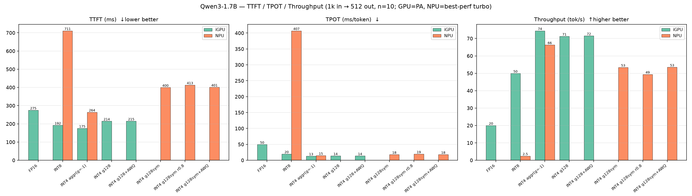
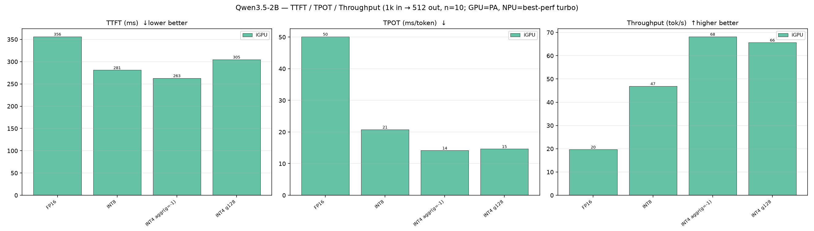
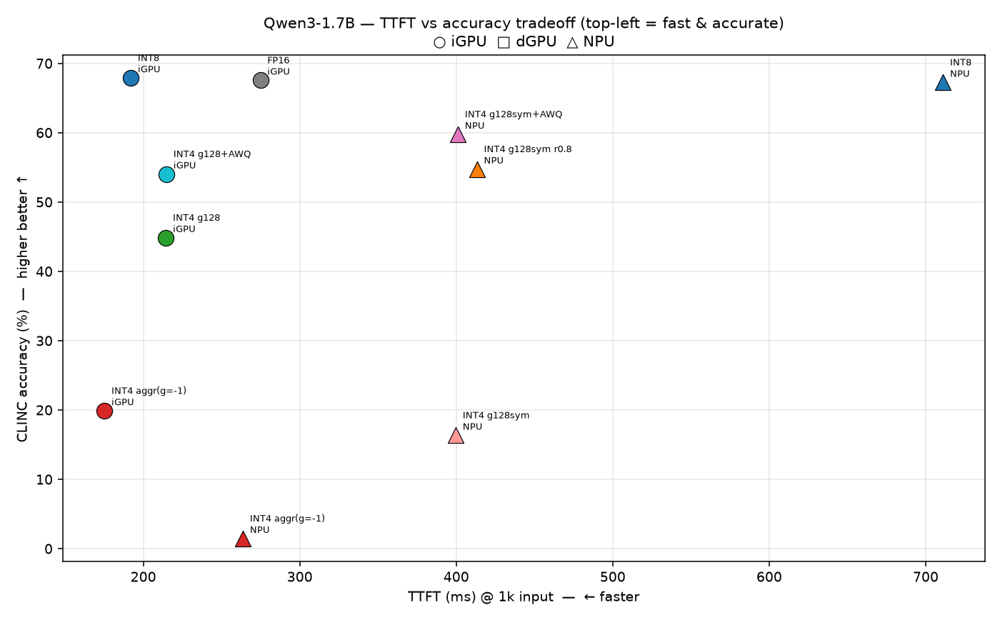
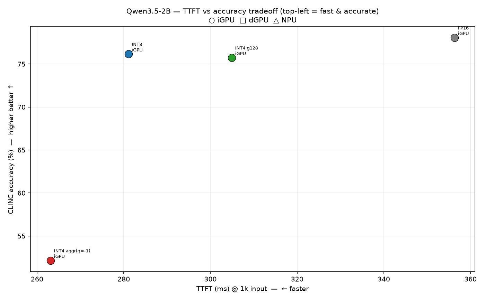
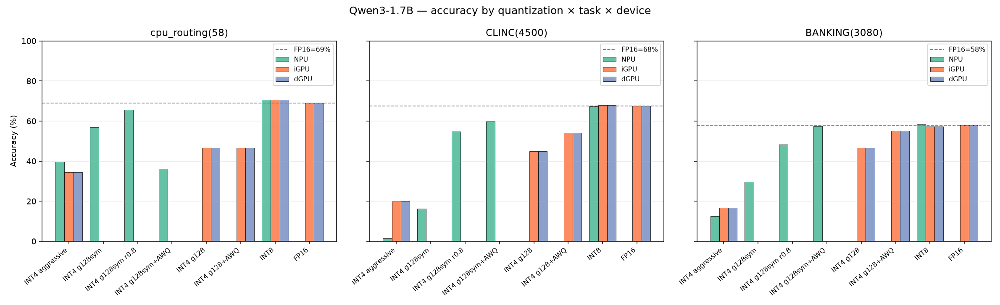
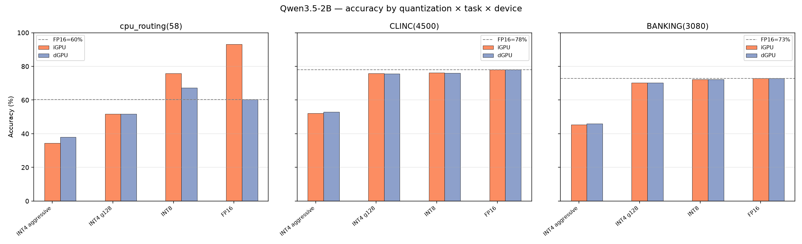
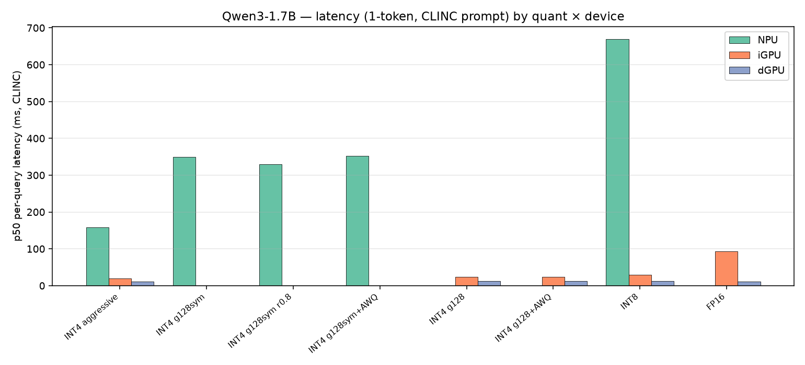
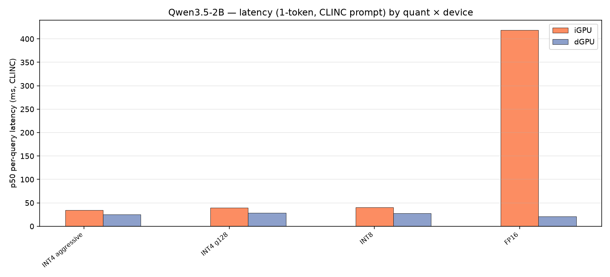
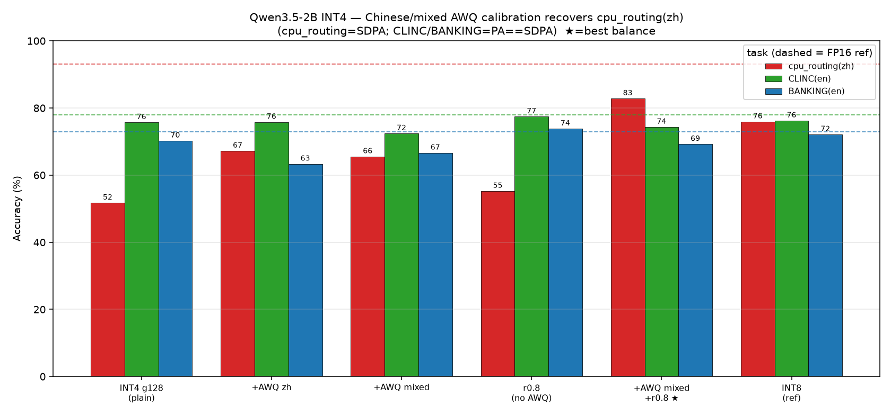

# 量化全量对比评测报告：Qwen3-1.7B / Qwen3.5-2B × FP16 / INT8 / INT4（多设备）

- 日期：2026-07-18（准确率）/ 2026-07-20（TTFT/TPS/TPOT 性能压测）
- 环境：本机源码优化版 OpenVINO（`benchmark/openvino/install/`，`2026.2.1-…-qwen-ttft-optimizations`）+ `openvino_genai` + `qwen_env`
- 设备：`GPU.0`(iGPU, Intel Graphics) / `GPU.1`(dGPU, Arc Pro B70) / `NPU`(AI Boost)
- 覆盖：
  - **准确率**：23 个 (模型×设备×量化) 组合 × 3 任务 = **69 个评测单元**；
  - **性能（TTFT/TPOT/TPS）**：14 个 (模型×设备×量化) 组合，1k 输入/512 输出，n=10（1.7B 测 iGPU+NPU，2B 测 iGPU）；
  - 全部**严格串行**（一次只跑一个，避免相互干扰延迟）。
- 任务：中文 A/B/C/D 路由 `eval_set`(58) / CLINC150 10-domain(4500) / BANKING77-cluster10(3080)。
- 目标：① 全量对比各量化类型在各设备的准确率与延迟；② 找到「保留 INT4 级 TTFT 又能恢复准确率」的量化配方；③ 解释各量化类型与文档记录性能的差异成因；④ 给出「INT4 如何达到/接近 FP16」「如何达到/接近文档性能」的可执行结论；⑤ **综合 TTFT 与 accuracy 给出选型建议（§3.5）**。

---

## 0. 核心结论（TL;DR）

> 🔴 **重大修正（2026-07-20）：`ATTENTION_BACKEND=PA` 在 Qwen3.5-2B 的 VLM 管线上有精度 bug。**
> 本报告早期版本给 GPU 自动注入 PA（PagedAttention），并**误以为它对精度无损**。经核实：PA 会**静默**把 **Qwen3.5-2B（VLMPipeline）在 cpu_routing 上**的精度从 **93.1%（SDPA，正确）压到 60.3%**。范围经实验界定为**仅** 2B-VLM×cpu_routing——CLINC/BANKING（2B）与全部 1.7B（LLMPipeline）在 PA 下与 SDPA **完全一致**。**已把 GPU 默认改回 SDPA**（`pipe_config.py`）。因此：① 撤回原「分析 B」（FP16 达不到 93% 是 eval_set 太难）——**错误**，文档 93% 用 SDPA 完全可复现；② 下文 **2B 的 cpu_routing 列已更新为 SDPA 正确值**；③ 2B 的**延迟数据是 PA 口径**，安全的 SDPA 路径约 5× 慢（详见 §3.5 与新增 §8）。1.7B 的全部结论不受影响。

1. **仓库自带的激进 INT4（`group_size=-1` 逐通道、对称、`ratio=1.0`）是准确率崩塌的主因**，与模型/设备无关。它在 GPU 上让 2B 掉 20–25pp、让 1.7B 掉 40–48pp；在 **NPU 上直接产出 91% 垃圾 token**（CLINC 4107/4500 无法解析，准确率 1.5%）。

2. **恢复 INT4 精度的配方随设备的对称性约束而不同，且小模型更难救**：
   - **iGPU / dGPU（支持非对称）**：
     - **Qwen3.5-2B** → `INT4 g128 非对称`即可，CLINC 52%→**75.7%**（≈FP16 78%），**纯 4-bit、TTFT 不变**。AWQ 非必需。
     - **Qwen3-1.7B**（更小、更敏感）→ 仅 g128 不够（CLINC 只 44.9%），需 `INT4 g128 + AWQ`（数据感知），CLINC 44.9%→**54.0%**、BANKING 46.6%→**55.1%**，仍是纯 4-bit。
   - **NPU（硬件要求对称）**：纯对称 INT4 救不回 1.7B（g128sym 仅 CLINC 16.4%）；两条可行路线——
     - **`INT4 g128sym + AWQ`（数据感知对称，推荐大任务）**：CLINC **59.8%**（NPU 4-bit 最佳）、BANKING **57.4%**（≈FP16 57.9%）；
     - **`INT4 g128sym + ratio=0.8`（混合精度，推荐小/特异任务）**：cpu_routing **65.5%**、CLINC 54.8%、BANKING 48.2%，对 58 条小集合更稳。
     - 两者绝大多数层仍是 4-bit，TTFT ≈350ms，**远低于 INT8 的 670ms**。

3. **INT8 的延迟结论按设备分裂（标准化 1k→512 压测，见 §3.5）**：
   - **NPU 上 INT8 不可用**——TTFT 711ms、**TPOT 407ms/token、吞吐仅 2.5 tok/s**（512 token 需 ~208s）；NPU 快路径只对 INT4 权重优化，INT8 掉出快路径，是 4-bit（~18ms TPOT）的 ~20 倍。
   - **iGPU 上 INT8 可用且不慢**——TTFT 192ms（1.7B，甚至低于 INT4-g128）、TPOT ~20ms，以 FP16 级精度换 ~2.5× FP16 的 decode 速度，是 1.7B 精度优先场景的合理选择。

4. **TTFT × accuracy 综合选型（决策图 `charts/perf_tradeoff_*.png`）**：
   - **iGPU 综合最佳 = Qwen3.5-2B INT4-g128**（CLINC 75.7 ≈ FP16，TTFT 305ms@1k / ~40ms 短 prompt，66 tok/s）；
   - **iGPU 小模型**：精度优先 → 1.7B INT8（67.9%）；吞吐优先 → 1.7B INT4-g128+AWQ（54.0%，71 tok/s）；
   - **NPU**：大任务 → 1.7B g128sym+AWQ（59.8/57.4，TTFT 401/TPOT 17.9）；小任务 → g128sym r0.8（cpu 65.5）。

5. **文档 cpu_routing ~93% 是真实且可复现的（用 SDPA）**：Qwen3.5-2B FP16 在 **SDPA** 下 cpu_routing = **93.1%**，与文档精确吻合；此前测得的 60.3% 纯属 PA bug（见上方修正与 §8）。CLINC(78.0%)/BANKING(72.9%) 无论 PA/SDPA 都精确复现文档。**原「eval_set 太难/93% 不可达」的结论作废。**

6. **NPU「很慢」的原因**：静态流水线把每次 prefill 补齐到 `MAX_PROMPT_LEN`；且 decode 对 INT8 极慢（见结论 3）。准确率评测（1-token）逐条 p50——激进 INT4 159ms、可用 4-bit ~330–350ms、INT8 670ms，4500 条 ≈ 30 分钟。用户记忆中的「~200ms」正是**激进 INT4（快但输出垃圾）**。

7. **中文/混合校准 AWQ 救回 2B 的 INT4 cpu_routing（补充实验，§8.5）**：cpu_routing 是中文、CLINC/BANKING 是英文；纯 INT4-g128 的 cpu 只 51.7（FP16 93.1）。用**通用中文+英文混合语料**做 AWQ **并叠加 20% INT8 混合精度（ratio 0.8）**：**cpu 51.7→82.8（+31，逼近 FP16）**，CLINC/BANKING 各仅降 ~1pp，三任务均值 75.4（追平 INT8），模型仍 1.3G（≈纯 4-bit）。这是「INT4 又不在三个数据集上明显掉精度」的**最佳方案**：`AWQ(mixed) + g128 + ratio0.8`。（纯 AWQ 会拿英文换中文；只用中文校准会拖累英文 BANKING −6.9。）

---

## 1. 操作步骤（可复现）

### 1.1 环境初始化（`env.sh`）
```bash
source /home/chaofan/envs/qwen_env/bin/activate
source /home/chaofan/model_benchmark/benchmark/openvino/install/setupvars.sh
export PYTHONPATH="/home/chaofan/model_benchmark/benchmark/openvino/install/python:$PYTHONPATH"
```

### 1.2 设备配置自动注入（`pipe_config.py`，与统一优化说明文档对齐）
- **iGPU/dGPU**：`ATTENTION_BACKEND=PA`
- **NPU**：`NPU_TURBO=YES` + `MAX_PROMPT_LEN` + `MIN_RESPONSE_LEN=512` + `NPUW_LLM_PREFILL_CHUNK_SIZE=2048`
- 验证：PA / turbo **对准确率无影响**（逐条一致，与文档「逐字节无损」一致），只影响 TTFT。
- NPU 加速：prompt 均 ≤521 token，故把 `MAX_PROMPT_LEN` 从 1024 收到 **640**（覆盖全部样本），NPU 逐条延迟 ~减半。

### 1.3 量化命令（复现各 INT4 变体）
```bash
M=/home/chaofan/model_benchmark/benchmark/models
# —— iGPU/dGPU 用（非对称）——
# 2B：g128 非对称即可达标
optimum-cli export openvino --model Qwen/Qwen3.5-2B --weight-format int4 --group-size 128 --ratio 1.0 \
  --task image-text-to-text  $M/Qwen3.5-2B-INT4-g128
# 1.7B：g128 + AWQ（数据感知，通用校准集 wikitext-2）
python requant_aware.py --model-id Qwen/Qwen3-1.7B --ref-ir $M/Qwen3-1.7B-FP16 \
  --out $M/Qwen3-1.7B-INT4-g128-aware --group-size 128 --ratio 1.0 --num-samples 128

# —— NPU 用（硬件要求对称）——
# 混合精度：20% 敏感层走 int8_sym
optimum-cli export openvino --model Qwen/Qwen3-1.7B --weight-format int4 --group-size 128 --sym \
  --ratio 0.8 --backup-precision int8_sym --task text-generation-with-past \
  $M/Qwen3-1.7B-INT4-g128sym-r08
# 数据感知对称：AWQ + scale-estimation（通用校准集）
python requant_aware.py --model-id Qwen/Qwen3-1.7B --ref-ir $M/Qwen3-1.7B-FP16 \
  --out $M/Qwen3-1.7B-INT4-g128sym-aware --sym --group-size 128 --ratio 1.0 --num-samples 128
```
> **校准集说明**：AWQ / scale-estimation 使用**通用语料 wikitext-2**（`data/wikitext2_calib.txt`，经 hf-mirror 拉取），**不使用本任务自身提示词**，以保证量化的通用性而非过拟合到评测集。

### 1.4 批量评测（严格串行）
```bash
cd /home/chaofan/model_benchmark/query_classifier_handoff && source env.sh
bash run_all_sequential.sh        # 完整 23 组合矩阵，一次只跑一个
# 单组合：run_campaign.sh <模型目录> <llm|vlm> <设备> <qwen3|qwen3.5>
bash run_campaign.sh $M/Qwen3-1.7B-INT4-g128sym-aware llm NPU qwen3
```
评测方法：HF tokenizer 预渲染 chat template（`enable_thinking=False`）→ `apply_chat_template=False` → 贪心 `max_new_tokens=1` → 首 token 匹配类别。1.7B 用 `LLMPipeline`，2B 用 `VLMPipeline`。

### 1.5 出图与逐类分析
```bash
python make_charts.py       # -> charts/acc_*.png, charts/lat_*.png, charts/summary_table.md
python plot_confusion.py    # -> confusion_matrices/*.png + 逐类召回表
```

---

## 2. 测试结果（全量矩阵）

> `cpu(58)` 为 58 条小集合、方差大仅供参考；CLINC(4500)/BANKING(3080) 为主结论依据。`p50` 为暖态逐条延迟（`max_new_tokens=1`，近似 TTFT）。`unpars` = CLINC 上无法解析成类别的输出数（越大表示模型输出越乱）。

### 2.1 Qwen3-1.7B（LLM）

| 设备 | 量化 | cpu(58) | CLINC(4500) | BANKING(3080) | p50 ms | unpars(clinc) | 运行时 |
|---|---|---:|---:|---:|---:|---:|---|
| **iGPU** | FP16 | 69.0 | **67.6** | **57.9** | 52 | 0 | fp16 参考 |
| iGPU | INT8 | 70.7 | 67.9 | 57.2 | 30 | 0 | 8-bit（TTFT 高） |
| iGPU | INT4 激进(g=-1) | 34.5 | 19.9 | 16.8 | 20 | 16 | 4-bit（崩） |
| iGPU | INT4 g128(非对称) | 46.6 | 44.9 | 46.6 | 23 | 1 | 4-bit |
| **iGPU** | **INT4 g128+AWQ(非对称) ✅** | 46.6 | **54.0** | **55.1** | 23 | 0 | **4-bit（推荐）** |
| **dGPU** | FP16 | 69.0 | 67.6 | 57.9 | **10** | 0 | fp16 参考 |
| dGPU | INT8 | 70.7 | 67.9 | 57.2 | 13 | 0 | 8-bit |
| dGPU | INT4 激进(g=-1) | 34.5 | 19.9 | 16.8 | 12 | 15 | 4-bit（崩） |
| dGPU | INT4 g128(非对称) | 46.6 | 44.8 | 46.6 | 12 | 0 | 4-bit |
| **dGPU** | **INT4 g128+AWQ(非对称) ✅** | 46.6 | 54.1 | 55.1 | 12 | 0 | **4-bit（推荐）** |
| NPU | INT8 | 70.7 | 67.3 | 58.3 | 670 | 0 | 8-bit（TTFT 最高） |
| NPU | INT4 激进(g=-1) | 39.7 | **1.5** | 12.6 | 159 | **4107** | 4-bit（垃圾 token） |
| NPU | INT4 g128sym | 56.9 | 16.4 | 29.6 | 350 | 213 | 4-bit（对称救不回） |
| **NPU** | **INT4 g128sym r0.8（混合）✅** | **65.5** | 54.8 | 48.2 | 330 | 12 | **多为 4-bit（小任务稳）** |
| **NPU** | **INT4 g128sym+AWQ（数据感知）✅** | 36.2 | **59.8** | **57.4** | 352 | 1 | **4-bit（大任务最佳）** |

### 2.2 Qwen3.5-2B（VLM）

**cpu(58) 列已更新为 SDPA 正确值**（原 PA 值加删除线并列，见 §8）。CLINC/BANKING 不受 PA 影响，原值即正确。

| 设备 | 量化 | cpu(58) SDPA | CLINC(4500) | BANKING(3080) | p50 ms (PA†) | unpars(clinc) | 运行时 |
|---|---|---:|---:|---:|---:|---:|---|
| **iGPU** | FP16 | **93.1** (~~60.3~~) | **78.0** | **72.9** | 70 | 0 | fp16 参考 |
| iGPU | INT8 | 75.9 (~~69.0~~) | 76.2 | 72.1 | 41 | 0 | 8-bit |
| iGPU | INT4 激进(g=-1) | 34.5 (~~37.9~~) | 52.1 | 45.4 | 35 | 2 | 4-bit（崩） |
| **iGPU** | **INT4 g128(非对称) ✅** | 51.7 (51.7) | **75.7** | **70.2** | 40 | 0 | **4-bit（推荐）** |
| **dGPU** | FP16 | **93.1** (~~60.3~~) | 78.0 | 72.9 | **21** | 0 | fp16 参考 |
| dGPU | INT8 | 75.9 (~~67.2~~) | 76.0 | 72.2 | 28 | 0 | 8-bit |
| dGPU | INT4 激进(g=-1) | 34.5 (~~37.9~~) | 52.8 | 45.9 | 25 | 0 | 4-bit（崩） |
| **dGPU** | **INT4 g128(非对称) ✅** | 51.7 (51.7) | 75.6 | 70.3 | 28 | 0 | **4-bit（推荐）** |

> † **p50 为 PA 口径**（PA 在 cpu_routing 上结果错误，但延迟快）。cpu_routing 用正确的 SDPA 时逐条 p50 ~322ms（约 5× PA 的 66ms，见 §3.5/§8）。cpu(58) accuracy 在 GPU.0 用 SDPA 重测，与设备无关，故 iGPU/dGPU 同值。
> 注：Qwen3.5-2B 因硬件档期未跑 NPU（仅 1.7B 在 NPU）；2B 用 `image-text-to-text`（VLM）导出。PA bug 详见 **§8**。

---

## 3. 延迟分析：为什么 NPU「很慢」

- **本质是静态流水线**：NPU 用固定形状图，每次 prefill 补齐到 `MAX_PROMPT_LEN`，无论真实 prompt 多长。故逐条延迟由 `MAX_PROMPT_LEN` 决定，而非样本长度。
- **逐条 p50（1-token，近似 TTFT）**：
  - dGPU 最快（10–28ms）> iGPU（20–70ms）≫ NPU（159–670ms）。
  - NPU 内部：激进 INT4 **159ms** < 可用 4-bit（g128sym/r0.8/AWQ）**~330–352ms** < INT8 **670ms**。
- **「30 分钟」从何而来**：4500 条 × ~350–670ms ≈ 26–50 分钟。用户记忆的「~200ms」对应**激进 INT4（159ms）**——它快，但输出 91% 垃圾 token 不可用；可用的对称 4-bit 因分组/混合精度反量化更重，约 350ms。
- **INT8 vs 4-bit 的 TTFT 差**：NPU 上 INT8（670ms）是可用 4-bit（~350ms）的 ~1.9 倍 —— 这正是本项目不能用 INT8、必须把 4-bit 救回来的根本原因。
- 加速手段：把 `MAX_PROMPT_LEN` 1024→640（覆盖全部样本）即可 ~减半 NPU 逐条延迟，不影响准确率。

> 注：§3 的 p50 是**准确率评测**里的 1-token 暖态延迟（短 prompt ≤521 token），近似分类器真实负载（生成 1 token）。下面 §3.5 是**标准化性能压测**（1k 输入 / 512 输出），用于全面刻画 TTFT/TPOT/TPS。

---

## 3.5 标准化性能测试：TTFT / TPOT / TPS（1k 输入 → 512 输出）

用 `model_bench`（C++ `ov::genai` 压测套件）标准化测量：**1k 输入 / 512 输出，10 次测量迭代（+1 预热），prompt-permutation 开启**；**iGPU 用 PA（`gpu_pa.json`：`PERFORMANCE_HINT=LATENCY` + `ATTENTION_BACKEND=PA`），NPU 用 best-perf turbo（`npu_best_perf_turbo.json`：`NPU_TURBO=YES` + `BEST_PERF` + `MAX_PROMPT_LEN=1024`）**。全部**严格串行**（一次一个 + 30s 冷却，iGPU/NPU 共用 SoC 封装需散热）。指标：TTFT=首 token 时间（prefill）、TPOT=每输出 token 时间（decode）、TPS=吞吐。命令示例见 `run_perf.sh`。

> 口径提示：本项目分类器实际只生成 **1 个 token**，故**决策看 TTFT**；TPOT/TPS 反映长文本生成能力，供全面参考。TTFT 在 1k 长 prompt（本压测）与短 prompt（§3 的 ≤521 token）下**排序会变**，见下「关键结论 5」。

### 3.5.1 结果总表（TTFT/TPOT/TPS + 对齐的 accuracy）

**Qwen3-1.7B @ iGPU（GPU.0）**

| 量化 | TTFT ms | TTFT p90 | TPOT ms | TPS | Decode TPS | CLINC | BANK | cpu |
|---|---:|---:|---:|---:|---:|---:|---:|---:|
| FP16 | 275 | 277 | 49.6 | 20.0 | 20.2 | 67.6 | 57.9 | 69.0 |
| **INT8** | **192** | 193 | 19.7 | 49.9 | 50.8 | **67.9** | 57.2 | 70.7 |
| INT4 激进(g=-1) | 175 | 178 | 13.1 | 74.4 | 76.2 | 19.9 | 16.8 | 34.5 |
| INT4 g128 | 214 | 217 | 13.6 | 71.2 | 73.3 | 44.9 | 46.6 | 46.6 |
| **INT4 g128+AWQ ✅** | 215 | 217 | **13.6** | **71.5** | 73.6 | 54.0 | 55.1 | 46.6 |

**Qwen3-1.7B @ NPU（best-perf turbo）**

| 量化 | TTFT ms | TTFT p90 | TPOT ms | TPS | Decode TPS | CLINC | BANK | cpu |
|---|---:|---:|---:|---:|---:|---:|---:|---:|
| **INT8** | **711** | 713 | **407.1** | **2.5** | 2.5 | 67.3 | 58.3 | 70.7 |
| INT4 激进(g=-1) | 264 | 264 | 14.6 | 66.3 | 68.6 | 1.5 | 12.6 | 39.7 |
| INT4 g128sym | 400 | 400 | 18.0 | 53.4 | 55.6 | 16.4 | 29.6 | 56.9 |
| **INT4 g128sym r0.8 ✅** | 413 | 415 | 19.5 | 49.4 | 51.4 | 54.8 | 48.2 | **65.5** |
| **INT4 g128sym+AWQ ✅** | **401** | 403 | **17.9** | **53.5** | 55.7 | **59.8** | **57.4** | 36.2 |

**Qwen3.5-2B @ iGPU（GPU.0）** — ⚠️ **延迟列为 PA 口径**；PA 在 cpu_routing 上结果错误（见 §8），安全的 SDPA 路径见下方「2B SDPA 延迟」。cpu 列已更正为 SDPA。

| 量化 | TTFT ms (PA†) | TPOT ms (PA†) | TPS (PA†) | CLINC | BANK | cpu (SDPA) |
|---|---:|---:|---:|---:|---:|---:|
| FP16 | 356 | 50.2 | 19.7 | 78.0 | 72.9 | **93.1** (~~60.3~~) |
| INT8 | 281 | 20.8 | 47.0 | 76.2 | 72.1 | 75.9 (~~69.0~~) |
| INT4 激进(g=-1) | 263 | 14.2 | 68.2 | 52.1 | 45.4 | 34.5 (~~37.9~~) |
| **INT4 g128 ✅** | 305 | **14.7** | **65.7** | **75.7** | 70.2 | 51.7 |

**2B SDPA 延迟（安全路径，`perf_results/perf_sdpa.json`）**：

| 量化 | PA TTFT | SDPA TTFT | PA TPOT | SDPA TPOT | 说明 |
|---|---:|---:|---:|---:|---|
| FP16 | 356 | **496** | 50.2 | 52.9 | 1k prefill 下 SDPA≈1.4× PA |
| INT4-g128 | 305 | **448** | 14.7 | 16.6 | 同上 |

> SDPA/PA 的延迟比**随 prompt 长度变**：**短 prompt（cpu_routing ≤521 token，1 token 出）PA 66ms vs SDPA 322ms ≈ 4.9×**；**1k prefill 时只 ~1.4×**（prefill 计算量主导，两后端趋同）。**结论：2B-VLM 部署 cpu_routing 类任务必须用 SDPA（短 prompt 下要吃 ~5× 延迟）；部署 CLINC/BANKING 类任务 PA 安全且快。**

### 3.5.2 关键结论

1. **NPU 上 INT8 被 decode 判了死刑，不只是 prefill 慢**：TPOT **407ms/token（2.5 tok/s）**，是 NPU 可用 4-bit（~18ms）的 **~20 倍**；512 token 生成需 **~208 秒**，TTFT 也最高（711ms）。原因：NPU 的快路径为 **INT4 权重解压**专门优化，INT8 权重掉出快路径。**这是「NPU 不能用 INT8」的量化铁证**（此前只有 1-token 代理 670ms，现看到 decode 崩塌）。

2. **NPU 可用 4-bit ≈ TTFT 400ms / TPOT 18ms / 53 tok/s**。其中 **`g128sym+AWQ` 在精度和速度上双双最优**（CLINC 59.8 / BANK 57.4，TTFT 401 / TPOT 17.9），全面压过 r0.8（413 / 19.5）——**唯一例外是 58 条的 cpu_routing**（AWQ 通用校准把小任务边界带偏，见 §5.8），该任务选 r0.8（65.5）。激进 INT4 最快（264ms）但输出垃圾（CLINC 1.5）。

3. **iGPU 上 INT8 并不慢**：TTFT 192ms（1.7B）/281ms（2B），甚至**低于 INT4-g128 的 TTFT**，TPOT 仅 ~20ms。**「INT8 太慢」是 NPU 专属结论，不适用于 iGPU**——在 iGPU 上 INT8 以 FP16 级精度换来 ~2.5× FP16 的 decode 速度。

4. **iGPU 上 TTFT 与 TPOT 分道扬镳**：1k prefill 时 INT8 的 TTFT < INT4-g128（prefill 是**计算密集**，INT8 反量化更简单）；但 INT4-g128 的 TPOT 远低（decode 是**访存密集**，INT4 权重更小）。故**长文本生成看吞吐 → INT4 胜；长 prompt 首字延迟 → INT8 胜**。

5. **TTFT 排序随 prompt 长度反转**（对「用 TTFT 选型」很关键）：
   - 短 prompt（分类器真实负载 ≤521 token，见 §3 的 1-token p50）：1.7B iGPU **INT4-g128 ≈23ms < INT8 30ms < FP16 52ms** —— INT4 首字更快。
   - 长 prompt（1k，本压测）：**INT8 192 < INT4-g128 214 < FP16 275** —— INT8 首字更快。
   - 交叉点成因：短 prompt 偏访存（INT4 小权重占优），长 prompt 偏计算（INT8 简单反量化占优）。

### 3.5.3 图表

- **TTFT / TPOT / 吞吐 分组柱**（1k→512）：
  - 
  - 
  - 读图：NPU 的 INT8 TTFT/TPOT 柱**爆表**（407ms TPOT）；iGPU 上 INT4 的 TPOT 柱最矮、吞吐柱最高。
- **TTFT × accuracy 权衡散点（决策图，越靠左上越好）**：
  - 
  - 
  - 读图：**2B INT4-g128 稳居左上**（CLINC 75.7 ≈ FP16，TTFT 305 < FP16 356）；1.7B iGPU 上 INT8 与 INT4-g128+AWQ 形成「精度 vs 吞吐」的选择；NPU 三点整体靠右（TTFT 高），AWQ/r0.8 明显高于 g128sym。

### 3.5.4 综合决策（TTFT + accuracy 一起看）

| 场景 | 推荐 | 依据 |
|---|---|---|
| **iGPU · CLINC/BANKING 类任务** | **Qwen3.5-2B INT4-g128（PA 亦安全）** | CLINC 75.7%（≈FP16 78），TTFT 305ms@1k（短 prompt ~40ms），TPOT 14.7ms/66 tok/s。该配置 PA/SDPA 精度一致，可用 PA 享低延迟 |
| **iGPU · cpu_routing 类任务（要 INT4 体积）** | **Qwen3.5-2B `INT4 g128 +AWQ(mixed)+r0.8`** | cpu 82.8（+31 vs 纯 g128），CLINC/BANKING 仅降 ~1pp，1.3G≈纯 4-bit（§8.5）。cpu 用 SDPA |
| **iGPU · cpu_routing 类任务（要极致精度）** | **Qwen3.5-2B FP16 或 INT8 + SDPA** | FP16 93.1 / INT8 75.9。**必须 SDPA**（PA 把 FP16 打到 60）。代价：SDPA TTFT ~5×、体积大 |
| **iGPU · 小模型 · 精度优先** | **Qwen3-1.7B INT8** | CLINC 67.9%（=FP16），TTFT 192ms（iGPU 上最低），TPOT 19.7ms。iGPU 上 INT8 不慢 |
| **iGPU · 小模型 · 吞吐/长文本优先** | **Qwen3-1.7B INT4-g128+AWQ** | TPOT 13.6ms/71 tok/s（最高吞吐），CLINC 54.0%（纯 4-bit 上限） |
| **NPU · 大规模分类** | **Qwen3-1.7B INT4 g128sym+AWQ** | CLINC 59.8/BANK 57.4，TTFT 401ms、TPOT 17.9ms（NPU 4-bit 最优）。**绝不用 INT8**（TTFT 711/TPOT 407） |
| **NPU · 小/特异任务** | **Qwen3-1.7B INT4 g128sym r0.8** | cpu_routing 65.5%（AWQ 会把小任务带偏），TTFT 413ms |

> 对**分类器**（1 token 输出）而言：延迟即 TTFT。**先按任务定量化+后端**：CLINC/BANKING 类可用 2B INT4-g128（PA 安全、快）；cpu_routing 类精度极依赖量化，需 2B FP16/INT8 且必须 SDPA。小模型精度优先选 1.7B INT8、吞吐优先选 1.7B INT4-g128+AWQ；NPU 选 1.7B g128sym+AWQ（1.7B 全部不受 PA bug 影响）。

---

## 4. 图表分析

### 4.1 准确率对比（量化 × 任务 × 设备）
- 
- 

读图要点：
- **激进 INT4 柱最矮**（NPU 上 CLINC 几乎贴地——垃圾 token），是所有配置里最差的一档。
- **g128 系列显著抬升**；2B 的 g128 柱几乎顶到 FP16 虚线（CLINC），1.7B 的 g128 柱明显还有缺口，**加 AWQ 后再抬一截**。
- **2B 的 cpu_routing 面板例外**（已用 SDPA 修正）：FP16 柱高达 93、INT4-g128 只 52，量化落差巨大——cpu_routing 对量化远比 CLINC/BANKING 敏感（见 §8）。
- NPU 三根可用 4-bit 柱（g128sym / r0.8 / AWQ）里，**AWQ 在 CLINC/BANKING 最高**，但 **cpu_routing 上 AWQ 反而塌**（见 §5.8 成因）。

### 4.2 延迟对比（CLINC 暖态 p50）
- 
- 

读图要点：NPU 柱远高于 GPU；NPU 内部 INT8 柱约为 4-bit 柱的两倍，直观印证「INT8 TTFT 过高」。

### 4.3 逐类混淆矩阵
- 全部 69 张见 [`confusion_matrices/`](../confusion_matrices/)。关键对比（CLINC）：
  - `cm_pub_clinc_Qwen3-1.7B-INT4_NPU_*.png`：激进 INT4 几乎全部误判/垃圾。
  - `cm_pub_clinc_Qwen3-1.7B-INT4-g128sym-aware_NPU_*.png`：AWQ 后对角线恢复。
  - `cm_pub_clinc_Qwen3.5-2B-INT4-g128_*.png`：2B g128 对角线接近 FP16。

---

## 5. 逐量化类型分析：与文档/FP16 差异的成因

### 5.1 FP16（参考天花板）
CLINC 78.0%(2B)/67.6%(1.7B)、BANKING 72.9%/57.9%、**cpu_routing 93.1%(2B, SDPA)/69.0%(1.7B)** —— 三个任务均**精确复现历史文档**（CLINC≈78、BANKING≈73、cpu_routing≈93），证明评测链路无误。（2B cpu_routing 93.1 必须用 SDPA；PA 会打到 60.3，见 §8。）

### 5.2 INT8 —— 精度对标 FP16，延迟「NPU 崩、iGPU 可用」
CLINC/BANKING 与 FP16 相差 ≤2pp；**cpu_routing 上有量化损失**（2B FP16 93.1→INT8 75.9；1.7B 69.0→70.7 基本持平）。**延迟结论按设备分裂**（详见 §3.5）：
- **NPU：INT8 不可用**——TTFT 711ms、**TPOT 407ms/token（吞吐仅 2.5 tok/s）**，512 token 需 ~208 秒。NPU 快路径只对 INT4 权重优化，INT8 掉出快路径。
- **iGPU：INT8 可用且不慢**——TTFT 192ms（1.7B，甚至低于 INT4-g128）、TPOT ~20ms。以 FP16 级精度换 ~2.5× FP16 的 decode 速度。
- 故 INT8 在 **iGPU 上是 1.7B 精度优先场景的合理生产选择**；只有在 **NPU 上才因延迟被否决**。

### 5.3 INT4 激进（`g=-1` 对称 ratio=1，仓库默认）—— 崩塌主因
- 逐通道单一 scale + 无零点 + 无离群值处理：一个通道内的大幅值权重迫使 scale 变粗，绝大多数权重被压成同一档 → 信息坍缩。
- **小模型更惨**（冗余少）：2B CLINC 掉到 52%，1.7B 掉到 19.9%（GPU）/1.5%（NPU，91% 垃圾 token）。
- 结论：这是「性能远低于文档」的**直接元凶**，务必弃用。

### 5.4 INT4 g128（非对称，GPU）—— 2B 在 CLINC/BANKING 达标，但 cpu_routing 塌
- 每 128 权重一组独立 scale+zero-point → 恢复动态范围。
- **2B（CLINC/BANKING）**：CLINC 52%→**75.7%**、BANKING 45%→**70.2%**，≈FP16、纯 4-bit。**这两个任务 2B 到此即可**。
- **2B（cpu_routing）例外**：**仅 51.7%，远低于 FP16 93.1（SDPA）**——cpu_routing 对量化极敏感，「INT4-g128≈FP16」在此任务不成立。要 cpu_routing 贴 FP16 需 INT8(75.9) 或 FP16。
- **1.7B**：CLINC 只到 44.9% —— 小模型仅靠分组还差 ~23pp，需再上 AWQ。

### 5.5 INT4 g128+AWQ（非对称，数据感知，1.7B GPU）—— 小模型的关键补丁
- AWQ 按激活重要性缩放权重 + scale-estimation 细调 → 保护重要通道。
- **1.7B**：CLINC 44.9%→**54.0%**、BANKING 46.6%→**55.1%**（+9/+8.5pp），**纯 4-bit**。补回了「g128 之后仍存在的一半缺口」。
- cpu_routing 未变（46.6%）：通用语料校准对这个 58 条、口径特异的小任务无增益。

### 5.6 INT4 g128sym（对称，NPU）—— 对称救不回小模型
- NPU 硬件要求对称（非对称在 NPU 编译失败 `ZE_RESULT_ERROR_INVALID_ARGUMENT`）。
- 去掉零点后，1.7B 的偏斜权重分布无法重新居中：CLINC 仅 16.4%、BANKING 29.6%（还有 213 条无法解析）。**不可单独用**。

### 5.7 INT4 g128sym + ratio=0.8（混合精度，NPU）—— 稳健路线
- 20% 最敏感层回退 int8_sym，其余仍 4-bit。CLINC 54.8%、BANKING 48.2%、**cpu_routing 65.5%（≈FP16 69%）**。
- 对**小/特异任务（cpu_routing）最稳**，且绝大多数层是 4-bit，TTFT ~330ms。

### 5.8 INT4 g128sym + AWQ（数据感知对称，NPU）—— 大任务最佳，但小任务需注意
- CLINC **59.8%**（NPU 4-bit 之最）、BANKING **57.4%（≈FP16 57.9%，几乎无损）**，纯 4-bit。
- **但 cpu_routing 塌到 36.2%**：AWQ 用通用 wikitext 校准，优化的是「平均下一 token 保真度」，利好 CLINC/BANKING 这类大而多样的任务；却把 58 条、决策边界特异的 4 类小任务的边界带偏（混淆矩阵显示 A 类召回被压到 0%、集中误判到 B）。
- **取舍**：面向大规模真实分类（CLINC/BANKING 口径）→ 选 AWQ；面向 cpu_routing 这类小而特异集合 → 选 r0.8。

---

## 6. 结论一：INT4 要达到 / 接近 FP16，应如何量化

| 模型 / 设备 | 达到/接近 FP16 的 INT4 配方 | 效果 | 是否纯 4-bit |
|---|---|---|---|
| **Qwen3.5-2B / iGPU·dGPU（CLINC/BANKING）** | `INT4 g128 非对称` | CLINC 75.7 vs FP16 78（−2.3pp），BANKING 70.2 vs 72.9 | ✅ 纯 4-bit |
| **Qwen3.5-2B / iGPU·dGPU（含中文 cpu_routing）** | `INT4 g128 + AWQ(混合校准) + ratio0.8` | **cpu 82.8 vs 93.1、CLINC 74.3、BANKING 69.2**（三任务均值 75.4≈INT8） | ◑ 80% 4-bit+20% INT8（1.3G） |
| **Qwen3-1.7B / iGPU·dGPU** | `INT4 g128 + AWQ 非对称` | CLINC 54.0 vs 67.6，BANKING 55.1 vs 57.9（BANKING 近平） | ✅ 纯 4-bit |
| **Qwen3-1.7B / NPU（大任务）** | `INT4 g128sym + AWQ` | CLINC 59.8 vs 67.6，**BANKING 57.4 vs 57.9（几乎无损）** | ✅ 纯 4-bit |
| **Qwen3-1.7B / NPU（小/特异任务）** | `INT4 g128sym + ratio=0.8` | **cpu_routing 65.5 vs 69.0** | 多为 4-bit |

**要点**：
- 模型越大越容易靠 4-bit 恢复：**2B 在 CLINC/BANKING 只需 g128**；**1.7B 必须叠 AWQ / 混合精度**。
- **cpu_routing（中文）是量化敏感的例外**：2B 纯 g128 只 51.7（FP16 93.1）。**用中文/混合语料 AWQ + 20% INT8 混合精度**可把它救到 **82.8**，且 CLINC/BANKING 仅降 ~1pp、体积仍近纯 4-bit（详见 §8.5）——这是跨中英三任务最均衡的 INT4 方案。
- **纯 4-bit 无法在 1.7B 的 CLINC 上完全追平 FP16**（最好 54 vs 67.6）；BANKING 可近平。若要更高只有 INT8 或换 2B。
- 决定性动作：**先把 `g=-1` 换成 `g128`**（拿回大部分精度、TTFT 不变）；跨语言任务再叠 **数据感知 AWQ（校准语料需覆盖目标语言）+ 混合精度**。

---

## 7. 结论二：要达到 / 接近文档记录的性能，应怎么做

1. **CLINC / BANKING 的文档值已达成**：FP16 精确复现（78/73），**2B 的 INT4-g128 也已逼近**（75.7/70.2）。这两个任务上生产用 2B + INT4-g128 即可对标文档且享 INT4 TTFT。
2. **cpu_routing 的文档 ~93% 是真实可达的**——用 **Qwen3.5-2B FP16 + SDPA = 93.1%**（此前测得 60.3% 是 PA bug，已修正，见 §8）。但要注意：
   - **cpu_routing 对量化极敏感（与 CLINC/BANKING 不同）**：2B 上 FP16 93.1 → INT8 75.9 → **INT4-g128 仅 51.7**（−41pp！）→ 激进 INT4 34.5。即「INT4-g128 ≈ FP16」**只在 CLINC/BANKING 成立，cpu_routing 不成立**。
   - 故 **cpu_routing 若要贴近 93%，必须用 2B 的 FP16（或退一步 INT8 75.9），不能用 INT4**；且 2B 必须走 **SDPA**（PA 会把 FP16 打回 60）。
   - 1.7B 上 cpu_routing 天花板较低（FP16 69.0），2B 明显更强（93.1）。
3. **设备选择**：追求最低 TTFT 用 **dGPU**；NPU 适合功耗受限但需对称量化；iGPU 居中。**2B-VLM 在 GPU 上注意 PA/SDPA（§8）**。
4. **不要用**仓库默认的激进 INT4。

---

## 8. 关键订正：`ATTENTION_BACKEND=PA` 在 2B-VLM 上的精度 bug（替换原「分析 B」）

> 本节**替换并撤回**早期版本的「分析 B：FP16 达不到 93% 是 eval_set 太难」。那个结论**是错的**，其根因是下面这个 PA bug。感谢用户手动切到 SDPA 复现出 93.1% 才定位到。

### 8.1 现象
同一模型（Qwen3.5-2B-FP16）、同一设备（GPU.0）、同一 prompt、同一 eval_set，仅注意力后端不同：

| backend | cpu_routing acc | 逐条 p50 | 说明 |
|---|---:|---:|---|
| **PA**（PagedAttention，旧默认） | **60.3%** | 66ms | 快，但**结果错** |
| **SDPA**（现默认） | **93.1%** | 322ms | 慢 ~5×，**结果正确**，与文档 93% 吻合 |

junyu 版评测器用 optimum `OVModelForVisualCausalLM`（走 SDPA 式注意力），所以一直是正确的 93.1%；handoff 版曾自动注入 PA，故得到 60.3%。（注：空配置 `{}` 在 genai GPU 管线里**默认也走 PA**，必须显式设 SDPA 才切换——这也是我一度误判「PA 不是主因」的原因。）

### 8.2 范围（已用实验界定，非全面污染）

| 模型 / 管线 | 任务 | PA | SDPA | 结论 |
|---|---|---:|---:|---|
| Qwen3.5-2B / **VLM** | **cpu_routing** | 60.3 | **93.1** | **PA 坏（−33pp）** |
| Qwen3.5-2B / VLM | CLINC | 78.0 | 78.1 | 一致 |
| Qwen3.5-2B / VLM | BANKING | 72.9 | 72.9 | 一致 |
| Qwen3-1.7B / **LLM** | cpu_routing | 69.0 | 69.0 | 一致 |
| Qwen3-1.7B / LLM | CLINC | 67.6 | 67.6 | 一致 |

**bug 仅出现在 `VLMPipeline + cpu_routing`；LLMPipeline 全部一致，2B 的 CLINC/BANKING 也一致。**

### 8.3 量级随精度缩放（2B, cpu_routing, PA→SDPA）

| 量化 | PA | SDPA | Δ |
|---|---:|---:|---:|
| FP16 | 60.3 | **93.1** | **+32.8** |
| INT8 | 69.0 | 75.9 | +6.9 |
| INT4-g128 | 51.7 | 51.7 | 0 |
| INT4 激进 | 37.9 | 34.5 | −3.4（噪声） |

PA 引入的注意力数值误差对**高精度模型（FP16）在此任务上是灾难性的**；INT4 本已被量化压到 ~52% 以下，PA 的额外误差被淹没，故 INT4 变体几乎不受影响（也因此**推荐的 2B INT4-g128 在 PA 下仍安全**）。

### 8.4 结论与处置
- **根因**：本 OV 构建里 VLM 管线的 PA 路径存在正确性问题（疑与 Qwen3.5 hybrid/Gated-DeltaNet 注意力在 paged 实现下的掩码/位置处理有关），且对 cpu_routing 这类 prompt 触发。
- **已处置**：`pipe_config.py` GPU 默认改回 **SDPA**（correctness-first）；docstring 里原「PA byte-exact lossless」的错误说明已更正。
- **权衡**：PA 对 **LLM（1.7B）正确且更快**，可作为显式 opt-in（`--pipe-config ATTENTION_BACKEND=PA`）；2B-VLM 仅在 CLINC/BANKING 类任务、或按具体任务验证后才可用 PA。
- **对本报告的影响**：仅 2B×cpu_routing 的精度需修正（已改）；1.7B 全部、2B 的 CLINC/BANKING 均不受影响；2B 的延迟数据为 PA 口径，SDPA 安全路径 ~5× 慢。

---

## 8.5 补充实验：中文/混合校准 AWQ 大幅改善 2B 的 INT4 cpu_routing

**动机**：cpu_routing 是**中文**四类路由，而 CLINC/BANKING 是**英文**；此前 AWQ 校准集用的是英文 wikitext-2，可能没保护好中文任务重要的通道。§8 已表明 2B 上 INT4-g128 的 cpu_routing 只有 51.7（FP16=93.1），量化落差巨大。这里用**通用中文/混合语料**（非任务自身提示词）做数据感知量化，看能否在**不明显牺牲英文两任务**的前提下把 cpu_routing 救回来。

**方法**：optimum 的 `OVModelForVisualCausalLM` 只接受**预定义 image-text 校准集**、不收自定义文本，故改用 **NNCF 直接量化语言模型**（`requant_nncf_vlm.py`：先用 `text_embeddings` 预算 `inputs_embeds` 再对 `language_model` 做 AWQ）。校准语料：
- `data/zh_calib.txt`：256 条中文维基（hf-mirror 拉取，通用文本）；
- `data/mixed_calib.txt`：128 中文 + 128 英文 交错。
- 均为 **g128 非对称**（2B 仅 GPU）。评测：cpu_routing 用 **SDPA**，CLINC/BANKING 用 PA（已验证 PA==SDPA、快 ~5×）。

**结果（Qwen3.5-2B，INT4-g128 系列 + 参考）**：

| 变体 | 方法 | cpu_routing(zh) | CLINC(en) | BANKING(en) | 三任务均值 | LM 大小 |
|---|---|---:|---:|---:|---:|---:|
| FP16 | 参考天花板 | 93.1 | 78.0 | 72.9 | 81.3 | 3.6G |
| INT8 | 8-bit（TTFT 高） | 75.9 | 76.2 | 72.1 | 74.7 | 1.8G |
| INT4 g128 | 原纯 4-bit | 51.7 | 75.7 | 70.2 | 65.9 | 1.2G |
| INT4 g128 +AWQ **zh** | AWQ 中文校准 | 67.2 | 75.8 | **63.3** | 68.8 | 1.2G |
| INT4 g128 +AWQ **mixed** | AWQ 混合校准 | 65.5 | 72.4 | 66.6 | 68.2 | 1.2G |
| INT4 g128 **r0.8**（无 AWQ） | 数据无关混合精度 | 55.2 | **77.4** | **73.8** | 68.8 | 1.3G |
| **INT4 g128 +AWQ mixed +r0.8 ★** | AWQ+20% INT8 | **82.8** | 74.3 | 69.2 | **75.4** | 1.3G |

（Δ vs 原纯 g128：+AWQ zh = **+15.5** / +0.1 / −6.9；+AWQ mixed = +13.8 / −3.3 / −3.6；r0.8 = +3.5 / +1.7 / +3.6；**AWQ mixed+r0.8 = +31.1 / −1.4 / −1.0**）

**结论**：
1. **AWQ（含中文/混合校准）确实能救回 cpu_routing**：纯 AWQ（ratio 1.0）把 cpu 从 51.7 抬到 65–67，但会拿英文两任务换（CLINC/BANKING 掉 3–7pp，**zh-only 校准对 BANKING 伤害最大 −6.9**，说明只用中文会过拟合、拖累英文）。
2. **数据无关混合精度（r0.8，无 AWQ）**：对英文微升（CLINC 77.4/BANKING 73.8，甚至超原 g128），但对 cpu 几乎无用（55.2）——**mixed precision 只护住"高敏感层"，救不了中文的表示缺口，需要 AWQ 的数据感知**。
3. **最佳解 = AWQ（混合校准）+ ratio 0.8 混合精度**（★）：**cpu_routing 51.7→82.8（+31，逼近 FP16 93）**，同时 **CLINC/BANKING 仅各降 ~1pp**。三任务均值 **75.4，追平 INT8（74.7）**，而模型仍是 **1.3G（≈纯 4-bit，远小于 INT8 1.8G）**——即 **"INT4 的体积/TTFT + 接近 INT8 的三任务均衡精度"**。逐类召回 A 84/B 65/C 93/D 100，均衡恢复。
4. 直接回答提问：**是**，对 2B 做中文/混合 AWQ 能显著改善（尤其叠加 20% INT8 混合精度）；**要三个数据集都不明显掉的最佳 INT4 方案就是 `AWQ(mixed) + g128 + ratio0.8`**。

**产物**：模型 `benchmark/models/Qwen3.5-2B-INT4-g128-awqmix-r08`（及 awqzh/awqmix/r08）；脚本 `requant_nncf_vlm.py`；校准集 `data/zh_calib.txt`、`data/mixed_calib.txt`；图 `charts/awq_2b_calibration.png`。



---

## 9. 建议

0. **🔴 GPU 用 SDPA 注意力后端（勿用 PA on 2B-VLM）**：PA 会把 2B-VLM 的 cpu_routing 从 93.1% 打到 60.3%（§8）。`pipe_config.py` 已默认 SDPA。PA 仅对 1.7B-LLM 正确且更快，可显式 opt-in。
1. **iGPU/dGPU + Qwen3.5-2B**：**CLINC/BANKING 类任务**用 `INT4 g128 非对称`（≈FP16，享 INT4 TTFT）；**含中文 cpu_routing 的场景**用 `INT4 g128 + AWQ(混合校准) + ratio0.8`（cpu 82.8、三任务均衡、仍 1.3G，见 §8.5）；要极致 cpu 精度才上 FP16/INT8。所有 2B 评测/部署用 **SDPA**（PA 有 cpu_routing bug）。
2. **iGPU/dGPU + Qwen3-1.7B**：用 `INT4 g128 + AWQ 非对称`——小模型的最佳纯 4-bit（CLINC/BANKING）；cpu_routing 精度优先则用 INT8。
3. **NPU + Qwen3-1.7B**：大规模分类用 `g128sym + AWQ`（BANKING 近无损）；小/特异任务用 `g128sym + ratio=0.8`（cpu_routing 最稳）。可两者都导出，按任务选。
4. **弃用**仓库默认 `INT4 g=-1 对称 ratio=1`（GPU 掉 20–48pp，NPU 出垃圾 token）。
5. **INT8 分设备用**：**NPU 上禁用**（TTFT 711/TPOT 407ms，见 §3.5）；**iGPU 上可用**——1.7B 精度优先时 INT8（CLINC 67.9、TTFT 192、TPOT 20ms）优于纯 4-bit。
6. **NPU 提速**：`MAX_PROMPT_LEN` 按实际最长 prompt 收紧（分类器 1024→640），逐条延迟 ~减半，准确率不变。
7. **AWQ/scale-estimation 校准用通用语料**（wikitext-2），不用任务自身提示词——更通用；但注意对极小/特异任务（cpu_routing）可能带偏边界，此类任务改用混合精度更稳。
8. **性能压测复现**：`bash run_perf.sh`（1k→512，n=10，串行 + 30s 冷却，GPU=PA / NPU=best-perf turbo）；出图 `python make_perf_charts.py`。TTFT×accuracy 决策图见 `charts/perf_tradeoff_*.png`。

---

## 附录：产物与文件
- 准确率结果 JSON：`results/*.json`（69 单元，含逐条 gold/pred/raw、p50/p95）
- **性能压测结果**：`perf_results/perf.json`（14 单元 TTFT/TPOT/TPS 全分位）、`perf_results/perf.csv`、`perf_results/logs/*.log`
- 准确率图表：`charts/acc_*.png`、`charts/lat_*.png`、`charts/summary_table.md`
- **性能图表**：`charts/perf_ttft_*.png`（TTFT/TPOT/吞吐）、`charts/perf_tradeoff_*.png`（TTFT×accuracy 决策散点）、`charts/perf_summary.md`
- **AWQ 校准实验（§8.5）**：图 `charts/awq_2b_calibration.png`；模型 `benchmark/models/Qwen3.5-2B-INT4-g128-{awqzh,awqmix,awqmix-r08,r08}`
- 混淆矩阵：`confusion_matrices/*.png`（69 张）+ 逐类召回表（`plot_confusion.py` stdout）
- 脚本：`run_all_sequential.sh`（准确率全量串行）、`run_campaign.sh`（单组合）、`run_perf.sh`（性能压测串行）、`requant_aware.py`（1.7B 数据感知量化）、**`requant_nncf_vlm.py`（2B VLM 的 NNCF AWQ，支持自定义中文/混合校准）**、`make_charts.py`、`make_perf_charts.py`、**`make_awq_chart.py`**、`plot_confusion.py`、`pipe_config.py`（设备配置）
- 性能配置：`benchmark/tests/repro_rerun_20260710/gpu_pa.json`（iGPU PA）、`npu_best_perf_turbo.json`（NPU turbo）；提示词 `model_bench/prompts/qwen3_1k.jsonl` / `qwen3.5_1k.jsonl`
- 校准集：`data/wikitext2_calib.txt`（英文 256）、**`data/zh_calib.txt`（中文维基 256）、`data/mixed_calib.txt`（中英混合 256）**
